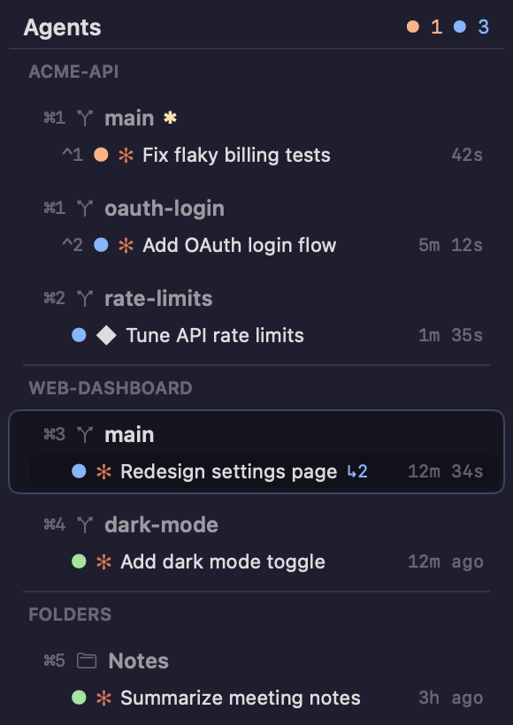

# cmux-agent-sidebar

A [cmux](https://github.com/manaflow-ai/cmux) sidebar that shows each coding agent, where it runs, and whether it's running, waiting on you or done. Use it as your left pane in place of the workspace list.



- One line per agent: status dot, `✻` Claude or `◆` Codex, title, time. `↳2` counts running subagents.
- Dots: blue running, orange waiting on you, green done, gray ○ ended.
- Click a row to switch to its workspace. Click an agent to jump to its terminal.
- No hooks, background jobs or network access. See [SECURITY.md](SECURITY.md).

## Install

You need cmux with Custom Sidebars on (the default, under **Settings → Custom Sidebars**). Start agents from a cmux terminal; cmux tracks them through its own `claude`/`codex` wrapper.

**From this repo:**

```sh
./install.sh
cmux sidebar select agents
```

Expect `1 valid, 0 invalid.` from the installer.

| Result | What to do |
|---|---|
| `backed up your existing …` | Your old `agents.js` is saved next to it as `agents.js.bak.<time>`. |
| `cmux is not on PATH` | Install cmux, open it once, then rerun. |
| `invalid` | Stop and keep the output. |

To check it, start `claude` or `codex` in a cmux workspace and send a prompt. A blue ● appears under its folder and turns green when it finishes.

To update, pull and rerun `./install.sh`. cmux reloads the file.

## How it groups

Each agent goes under its tab's folder. Checkouts of one git repo share a header; everything else goes under `FOLDERS`.

| Folder | Shown as |
|---|---|
| `<parent>/<repo>` | `branch`, under `REPO` |
| `<parent>/worktrees/<repo>/<folder>/…` | `folder`, under `REPO` |
| Any other folder | folder name, under `FOLDERS` |
| Workspace with no folder | workspace name, under `FOLDERS` |

- The sidebar can't run git, so it finds repos by that folder layout. A worktree kept elsewhere gets its own header.
- A worktree is named by its first folder, not its branch, so name worktree folders after their branch. An agent in a subfolder stays in its worktree's group.
- A workspace in a repo's subfolder joins that checkout's row when another workspace is open on the checkout, on the same branch.
- A `_` or `.` folder (`_claude`, `.dotfiles`) never counts as a repo, even a real one. With no checkout to join, it goes under `FOLDERS`.
- `✱` means uncommitted changes. Worktree rows never show it: cmux only updates branch and `✱` at a shell prompt, so they go stale once an agent moves.
- `⌘N` selects the row's workspace. `⌃N` on an agent is its tab, shown when the workspace has more than one.
- Rows don't move when you switch tabs or an agent changes status. Repos follow workspace order, main checkout first; agents follow tab order.
- cmux moves a workspace to the top when it gets a notification. To keep `⌘N` fixed, set `"app": { "reorderOnNotification": false }` in `~/.config/cmux/cmux.json` and run `cmux reload-config`.

Best results: one workspace per worktree, with agents started inside it.

```sh
cmux new-workspace --cwd <parent>/worktrees/<repo>/<branch>
```

## Follow an agent into a worktree

Optional, Claude Code only. Use it if your agents create worktrees mid-conversation.

cmux learns a tab's folder from the shell prompt (OSC 7). A running agent prints no prompt, so cmux keeps the folder it started in. You need a Claude Code [`statusLine`](https://code.claude.com/docs/en/statusline) script and `jq`.

**1. Add to `~/.claude/CLAUDE.md`:**

```md
- After creating a git worktree for a task, switch the session into it with the EnterWorktree tool (pass the worktree as `path`). Don't work in it with `git -C` or absolute paths from the original folder.
```

`cd` and `git -C` don't move the session; `EnterWorktree` does.

**2. Add to your status line script, after it reads its input into `$input`:**

```sh
# report the session folder to the terminal (OSC 7), so cmux follows a
# session into a worktree; the shell only reports it at a prompt. This script
# has no controlling tty, so write to the nearest ancestor's terminal.
cwd=$(echo "$input" | jq -r '.workspace.current_dir // .cwd // ""')
if [ -n "$cwd" ]; then
  pid=$PPID
  for _ in 1 2 3 4; do
    t=$(ps -o tty= -p "$pid" 2>/dev/null | tr -d ' ')
    case "$t" in
      ""|"??") pid=$(ps -o ppid= -p "$pid" 2>/dev/null | tr -d ' '); [ -n "$pid" ] || break ;;
      *) { printf '\033]7;file://%s%s\033\\' "$(hostname)" "$cwd" > "/dev/$t"; } 2>/dev/null; break ;;
    esac
  done
fi
```

It writes one escape code to the agent's own tab. It lives in your Claude Code config, not this sidebar.

**3. Check:** ask Claude to enter an existing worktree. Within a few seconds the status line shows the worktree and the agent moves to that row in the sidebar.

| Result | What to do |
|---|---|
| Status line shows the old folder | Claude didn't use `EnterWorktree`. Ask it to, and check step 1. |
| Status line moved, sidebar didn't | Check that `statusLine` runs the script you edited, then look for the worktree in `cmux current --json \| grep '"cwd"'`. |

Codex has no equivalent; start it inside the worktree.

## Tips

- **Rename an agent:** press ⌘R in its tab, or `cmux rename-tab --surface <surface> "<name>"` (`cmux tree` lists surfaces). An untitled tab shows the agent's first prompt.
- **Width:** drag the sidebar's edge. Rows truncate instead of wrapping.
- **Hide:** bind cmux's `toggleSidebar` shortcut. cmux has no auto-hide.

## Known limits

- **Background subagents drop out of `↳N` early.** cmux marks a subagent done when the call that started it returns.
- **Tab keys assume no split panes.** cmux numbers tabs per pane, but the sidebar sees one list, so `⌃N` can be wrong with splits.
- **Two workspaces on one folder share a row.** Clicking it opens the selected one, else the first.
- **No grouping by edited files.** That would need hooks.

## Development

```sh
npm test
```

- No dependencies. Node 22+ built-in test runner.
- `tests/harness.mjs` loads `sidebars/agents.js` with cmux's API stubbed. The stubs can't prove the real render, so run `./install.sh` and look after a change.
- Design and status colors: [docs/design.md](docs/design.md).

## License

[MIT](LICENSE)
